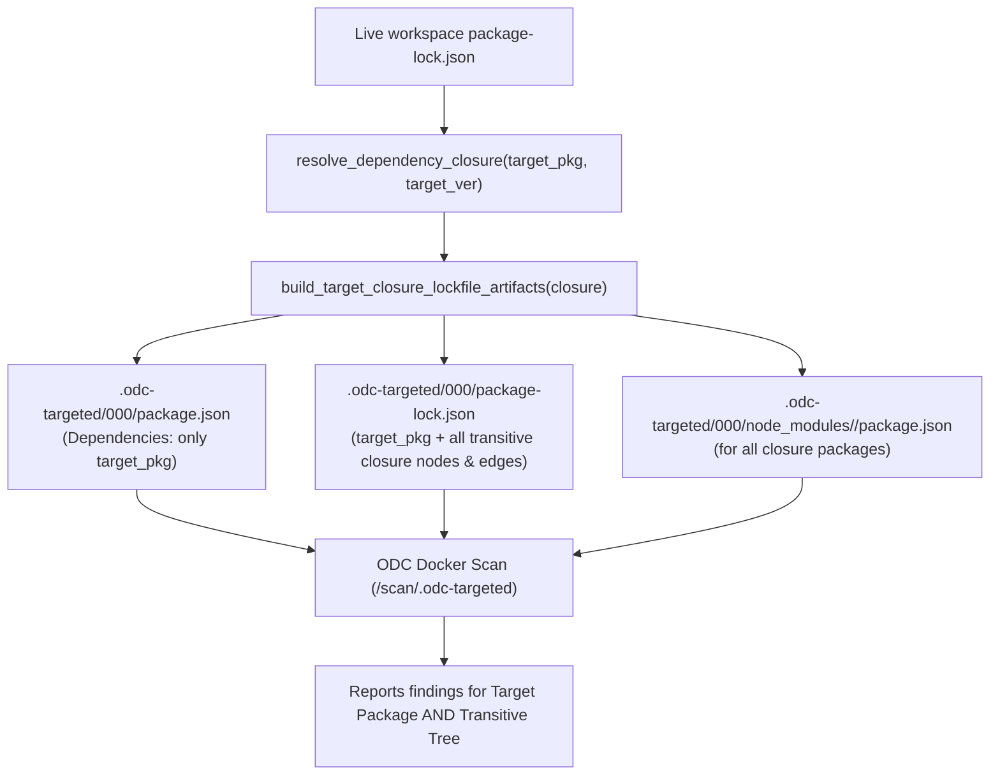
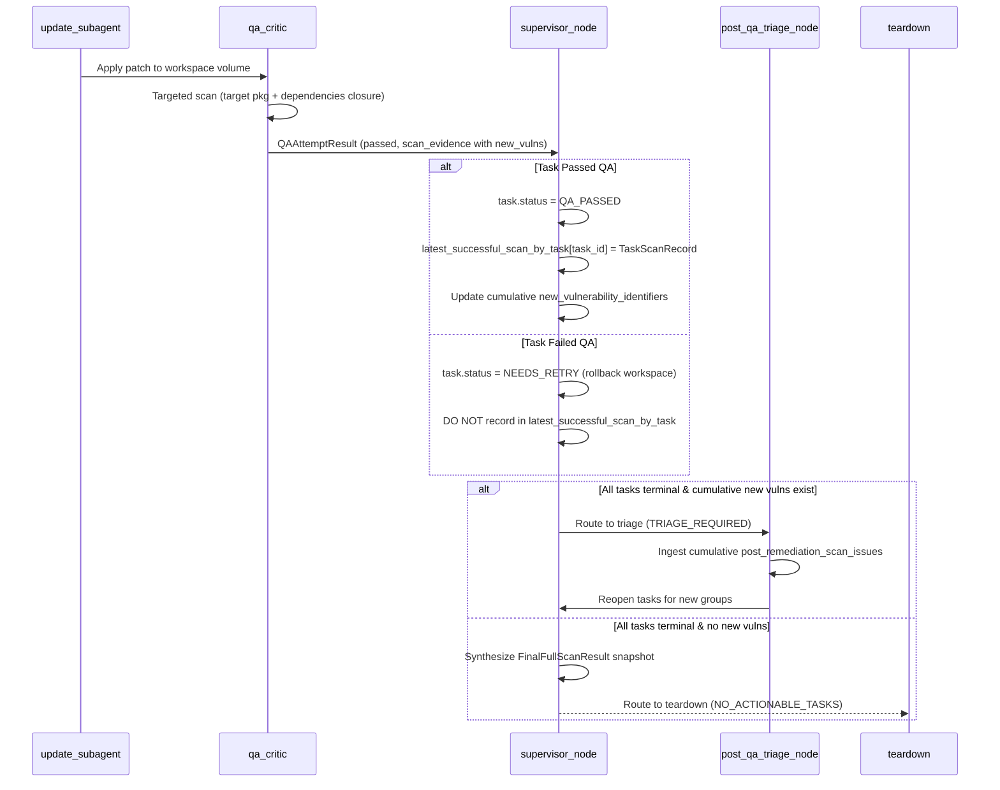

# Implementation Plan: Additive Targeted ODC Scans & Supervisor State Feedback

## 1. Executive Summary & Goals

| Requirement | Current Architecture | Proposed Architecture |
|---|---|---|
| **1. Target Package & Dependencies Targeted Scan** | [`build_target_only_lockfile_artifacts`](file:///Users/wylandee/.omp/wt/wt-20260917-124346-a8f1544/src/remediation_engine/tools/lockfile_closure.py#L478) deliberately strips all dependency edges from the target package, scanning only that package in isolation. Transitive dependencies are omitted. | Use [`resolve_dependency_closure`](file:///Users/wylandee/.omp/wt/wt-20260917-124346-a8f1544/src/remediation_engine/tools/lockfile_closure.py#L264) to extract the target package's transitive closure from the workspace lockfile. Generate a synthetic `package.json` with only the target package at root, and a `package-lock.json` containing only that package and its related dependencies with their edges intact. |
| **2. Additive Scans & Removal of Final Full Scan** | A standalone Docker node (`final_full_scan`) runs after all tasks become terminal to scan the full repository before teardown. | Targeted scan findings are additive across iterations. The cumulative newly discovered vulnerabilities list replaces the final full scan. Retriage triggers directly from this cumulative list; the `final_full_scan` Docker node is retired from the LangGraph workflow. |
| **3. Supervisor Feedback on `qa_passed`** | When a task passes QA, the supervisor only transitions `status = QA_PASSED` and appends a constraint to `constraints_ledger`. Scanner results are discarded. | Scanner findings (`new_identifiers`, `found_issues`, `found_identifiers`, `closure_package_names`) are fed back into the Supervisor state upon each successful QA pass. A per-task `latest_successful_scan_by_task` ledger prevents stale vulnerabilities from failed attempts. |

---

## 2. Requirement 1: Targeted ODC Scan of Target Package and Its Dependencies

### Current Behavior & Limitations
In [`lockfile_closure.py:build_target_only_lockfile_artifacts`](file:///Users/wylandee/.omp/wt/wt-20260917-124346-a8f1544/src/remediation_engine/tools/lockfile_closure.py#L478-L553):
- All dependency blocks (`dependencies`, `optionalDependencies`, `peerDependencies`, `peerDependenciesMeta`) are removed from the target package metadata.
- Synthetic files written:
  1. `package.json`: `{ "dependencies": { "<target_pkg>": "<target_ver>" } }`
  2. `package-lock.json`: `{ "packages": { "": { ... }, "node_modules/<target_pkg>": { ... } } }` (edges stripped)
  3. `node_modules/<target_pkg>/package.json`
- **Limitation:** If upgrading `pkg-a` introduces a vulnerable transitive dependency `pkg-b@2.0.0`, the targeted QA scan will not detect it. Only the final full scan would notice the regression.

### Proposed Solution: Dependency Closure Slicing
1. **Closure Resolution**:
   - For each target package in `scan_targets`, call [`resolve_dependency_closure(packages, source_lockfile, target_package, target_version, dependency_ancestry, lockfile_version)`](file:///Users/wylandee/.omp/wt/wt-20260917-124346-a8f1544/src/remediation_engine/tools/lockfile_closure.py#L264).
   - This traverses `dependencies`, `optionalDependencies`, and `peerDependencies` through the live lockfile's `packages` map to produce a complete [`DependencyClosure`](file:///Users/wylandee/.omp/wt/wt-20260917-124346-a8f1544/src/remediation_engine/tools/lockfile_closure.py#L58-L68).

2. **Synthetic Artifact Generation (`build_target_closure_lockfile_artifacts`)**:
   Implement a new helper in [`lockfile_closure.py`](file:///Users/wylandee/.omp/wt/wt-20260917-124346-a8f1544/src/remediation_engine/tools/lockfile_closure.py):
   - **`package.json`**:
     ```json
     {
       "name": "remediation-engine-targeted-scan",
       "version": "0.0.0",
       "private": true,
       "dependencies": {
         "<target_pkg>": "<target_ver>"
       }
     }
     ```
   - **`package-lock.json`**:
     - `packages[""]`: Root entry declaring only `dependencies: { "<target_pkg>": "<target_ver>" }`.
     - `packages`: Retains `node_modules/<target_pkg>` **plus all nodes in `closure.nodes`** with their child dependency edges intact.
   - **`node_modules` Minimal Manifests**:
     - For every node in `closure.nodes`, write `node_modules/<node.package_name>/package.json`:
       ```json
       {
         "name": "<node.package_name>",
         "version": "<node.version>"
       }
       ```
     - This guarantees that ODC's RetireJS and filesystem analyzers discover every package in the closure without needing an `npm install` inside the targeted container.

3. **Workspace Materialization & Verification**:
   - In [`_qa_runtime.py:_write_targeted_artifacts`](file:///Users/wylandee/.omp/wt/wt-20260917-124346-a8f1544/src/remediation_engine/orchestration/_qa_runtime.py#L1621), call `build_target_closure_lockfile_artifacts`.
   - In [`qa_critic.py:_run_global_execution`](file:///Users/wylandee/.omp/wt/wt-20260917-124346-a8f1544/src/remediation_engine/orchestration/qa_critic.py#L228-L257), update `expected_packages` to verify that ODC enumerates all packages present in the closure.
   - Attach all closure package names to [`ODCScanEvidence.closure_package_names`](file:///Users/wylandee/.omp/wt/wt-20260917-124346-a8f1544/src/remediation_engine/contracts/schemas.py#L1540).



---

## 3. Requirement 2: Additive Targeted Scans, Removal of Final Full Scan, & Retriage

### Stale Vulnerability Invariant
> [!IMPORTANT]
> **Why stale vulnerabilities occur:**
> In the task-queue retry workflow, if Attempt 1 updates `pkg-a` to `v2.0.0` (which introduces `CVE-NEW-1`) but fails unit tests, Attempt 1 fails QA. The workspace is then rolled back to the pre-attempt snapshot.
> If Attempt 2 pivots or selects `v2.1.0` and passes QA without `CVE-NEW-1`, simply appending scan findings across attempts would falsely retain `CVE-NEW-1`.
>
> **The Invariant:**
> 1. Failed QA attempts **never** record scan results into the cumulative ledger.
> 2. Each task's successful QA **replaces** any prior scan result for that `task_id`.
> 3. The cumulative newly discovered vulnerabilities list is computed as the aggregate of `latest_successful_scan_by_task` across tasks currently in [`TaskStatus.QA_PASSED`](file:///Users/wylandee/.omp/wt/wt-20260917-124346-a8f1544/src/remediation_engine/contracts/schemas.py#L222).

### Removing the `final_full_scan` Node
1. **LangGraph Workflow (`graph.py`)**:
   - In [`build_orchestrator_graph`](file:///Users/wylandee/.omp/wt/wt-20260917-124346-a8f1544/src/remediation_engine/orchestration/graph.py#L1305-L1336):
     - Remove `workflow.add_node("final_full_scan", run_final_full_scan_node)`.
     - Remove `workflow.add_conditional_edges("final_full_scan", route_after_final_full_scan)`.
     - Remove `route_after_final_full_scan`.
2. **Supervisor State Machine & Router**:
   - In [`supervisor_node.py`](file:///Users/wylandee/.omp/wt/wt-20260917-124346-a8f1544/src/remediation_engine/orchestration/supervisor_node.py#L142-L150), remove `"final_full_scan"` from `_VALID_NEXT_NODES`.
   - In [`supervisor_node.py:supervisor_router`](file:///Users/wylandee/.omp/wt/wt-20260917-124346-a8f1544/src/remediation_engine/orchestration/supervisor_node.py#L3730-L3761), remove the router interception that forced `step = "final_full_scan"` when all tasks became terminal.
   - In [`supervisor_routing.py:_deterministic_routing`](file:///Users/wylandee/.omp/wt/wt-20260917-124346-a8f1544/src/remediation_engine/orchestration/supervisor_routing.py#L227-L243):
     - Replace `DecisionCode.FINAL_FULL_SCAN_REQUIRED` with direct terminal decision-making:
       - If `cumulative_new_identifiers` is non-empty and `post_qa_retriage_count < remedy_retriage_limit`:
         ```python
         SupervisorDecision(
             decision_code=DecisionCode.TRIAGE_REQUIRED,
             next_node="triage",
             target_task_ids=[],
             instructions="Route cumulative newly discovered vulnerabilities to post-QA retriage.",
             decision_reason="All tasks are terminal and cumulative targeted scans detected new vulnerabilities.",
         )
         ```
       - Else:
         ```python
         SupervisorDecision(
             decision_code=DecisionCode.NO_ACTIONABLE_TASKS,
             next_node="teardown",
             target_task_ids=[],
             instructions="All tasks are terminal and no further retriage is required. Proceeding to teardown.",
             decision_reason="No actionable tasks or new vulnerabilities remain.",
         )
         ```

### Terminal Snapshot Synthesis for Backward Compatibility
Downstream modules ([`report_node.py`](file:///Users/wylandee/.omp/wt/wt-20260917-124346-a8f1544/src/remediation_engine/orchestration/report_node.py), [`report_context.py`](file:///Users/wylandee/.omp/wt/wt-20260917-124346-a8f1544/src/remediation_engine/orchestration/report_context.py), evals, and trajectory exports) expect [`FinalFullScanResult`](file:///Users/wylandee/.omp/wt/wt-20260917-124346-a8f1544/src/remediation_engine/contracts/schemas.py#L1559).
When all tasks reach terminal status and routing to teardown, the Supervisor synthesizes a `FinalFullScanResult` snapshot directly from the cumulative metrics:
```python
final_full_scan_result = FinalFullScanResult(
    completed=True,
    authoritative=True,
    found_identifiers=sorted(cumulative_found_identifiers),
    remaining_target_identifiers=[],
    new_identifiers=sorted(cumulative_new_identifiers),
    found_issues=list(cumulative_issues_by_fingerprint.values()),
    status="detected" if cumulative_new_identifiers else "none",
    triage_required=bool(cumulative_new_identifiers),
)
```
This preserves 100% backward compatibility without running an extra Docker scan container.

---

## 4. Requirement 3: Feeding Scanner Results into Supervisor State on QA Pass

### Data Model Enhancements
1. **Extend [`ODCScanEvidence`](file:///Users/wylandee/.omp/wt/wt-20260917-124346-a8f1544/src/remediation_engine/contracts/schemas.py#L1531)**:
   Add fields to transport newly discovered findings through the attempt envelope:
   ```python
   new_identifiers: list[str] = Field(default_factory=list)
   found_issues: list[VulnerabilityIssue] = Field(default_factory=list)
   ```

2. **Add `TaskScanRecord` to [`contracts/schemas.py`](file:///Users/wylandee/.omp/wt/wt-20260917-124346-a8f1544/src/remediation_engine/contracts/schemas.py)**:
   ```python
   class TaskScanRecord(BaseModel):
       """Scanner evidence snapshot from a successful task QA iteration."""
       model_config = ConfigDict(frozen=True, extra="forbid")

       task_id: str
       attempt_id: str
       task_revision: int
       new_identifiers: list[str] = Field(default_factory=list)
       found_identifiers: list[str] = Field(default_factory=list)
       found_issues: list[VulnerabilityIssue] = Field(default_factory=list)
       closure_package_names: list[str] = Field(default_factory=list)
       recorded_at: str
   ```

3. **Extend [`OrchestratorState`](file:///Users/wylandee/.omp/wt/wt-20260917-124346-a8f1544/src/remediation_engine/orchestration/state.py#L433)**:
   ```python
   latest_successful_scan_by_task: Annotated[dict[str, TaskScanRecord], replace_dict_reducer]
   ```
   Initialize with `{}` in [`initial_orchestrator_state`](file:///Users/wylandee/.omp/wt/wt-20260917-124346-a8f1544/src/remediation_engine/orchestration/state.py#L591).

### Supervisor Ingestion Logic
In [`supervisor_node.py`](file:///Users/wylandee/.omp/wt/wt-20260917-124346-a8f1544/src/remediation_engine/orchestration/supervisor_node.py#L2305-L2320) (Stage 4 QA Result Ingestion):
```python
if evaluation.passed:
    _commit_task_transition(
        task_queue,
        resolved_t_id,
        updates={"status": TaskStatus.QA_PASSED},
    )
    # Feed back scanner results into supervisor state:
    scan_evidence = evaluation.scan_evidence or scan_evidence_by_task.get(resolved_t_id)
    if scan_evidence is not None:
        latest_successful_scan_by_task[resolved_t_id] = TaskScanRecord(
            task_id=resolved_t_id,
            attempt_id=attempt_id,
            task_revision=task.task_revision,
            new_identifiers=list(scan_evidence.new_identifiers),
            found_identifiers=list(scan_evidence.found_identifiers),
            found_issues=list(scan_evidence.found_issues),
            closure_package_names=list(scan_evidence.closure_package_names),
            recorded_at=datetime.now(UTC).isoformat(),
        )
```

### Cumulative Vulnerability Calculation
Implement `_calculate_cumulative_scan_metrics` in [`supervisor_node.py`](file:///Users/wylandee/.omp/wt/wt-20260917-124346-a8f1544/src/remediation_engine/orchestration/supervisor_node.py):
```python
def _calculate_cumulative_scan_metrics(
    task_queue: Mapping[str, RemediationTask],
    latest_successful_scan_by_task: Mapping[str, TaskScanRecord],
) -> tuple[list[str], list[str], list[VulnerabilityIssue]]:
    """Derive cumulative newly discovered and found vulnerabilities from passed tasks only."""
    cumulative_new_identifiers: set[str] = set()
    cumulative_found_identifiers: set[str] = set()
    cumulative_issues_by_fingerprint: dict[str, VulnerabilityIssue] = {}

    for task_id, scan_record in latest_successful_scan_by_task.items():
        task = task_queue.get(task_id)
        # INVARIANT: Only tasks that are currently QA_PASSED contribute
        if task is None or task.status != TaskStatus.QA_PASSED:
            continue
        cumulative_new_identifiers.update(scan_record.new_identifiers)
        cumulative_found_identifiers.update(scan_record.found_identifiers)
        for issue in scan_record.found_issues:
            issue_ident = (issue.cve_id or issue.ghsa_id or "").upper().strip()
            if issue_ident in scan_record.new_identifiers:
                fp = _stable_issue_fingerprint(issue)
                cumulative_issues_by_fingerprint.setdefault(fp, issue)

    return (
        sorted(cumulative_new_identifiers),
        sorted(cumulative_found_identifiers),
        list(cumulative_issues_by_fingerprint.values()),
    )
```

Project these metrics into `OrchestratorState`:
- `new_vulnerability_identifiers = sorted(cumulative_new_identifiers)`
- `post_remediation_scan_identifiers = sorted(cumulative_found_identifiers)`
- `post_remediation_scan_issues = list(cumulative_issues_by_fingerprint.values())`
- `new_vulnerability_status = "detected" if cumulative_new_identifiers else "none"`
- `triage_required = bool(cumulative_new_identifiers) and not post_qa_retriage_limit_reached`



---

## 5. File Modification Matrix

| File Path | Component | Changes Required |
|---|---|---|
| [`src/remediation_engine/contracts/schemas.py`](file:///Users/wylandee/.omp/wt/wt-20260917-124346-a8f1544/src/remediation_engine/contracts/schemas.py) | Contracts | 1. Add `TaskScanRecord` model.<br/>2. Add `new_identifiers` and `found_issues` to `ODCScanEvidence`.<br/>3. Update docstrings. |
| [`src/remediation_engine/tools/lockfile_closure.py`](file:///Users/wylandee/.omp/wt/wt-20260917-124346-a8f1544/src/remediation_engine/tools/lockfile_closure.py) | Lockfile Closure | 1. Implement `build_target_closure_lockfile_artifacts` using `resolve_dependency_closure`.<br/>2. Include minimal `node_modules/<pkg>/package.json` for all closure nodes. |
| [`src/remediation_engine/orchestration/_qa_runtime.py`](file:///Users/wylandee/.omp/wt/wt-20260917-124346-a8f1544/src/remediation_engine/orchestration/_qa_runtime.py) | QA Runtime | 1. Update `_write_targeted_artifacts` to use `build_target_closure_lockfile_artifacts`.<br/>2. Update `_scan_evidence` to forward `new_identifiers` and `found_issues`. |
| [`src/remediation_engine/orchestration/qa_critic.py`](file:///Users/wylandee/.omp/wt/wt-20260917-124346-a8f1544/src/remediation_engine/orchestration/qa_critic.py) | QA Critic | 1. Update `expected_packages` check to cover closure dependencies.<br/>2. Deprecate / remove `run_final_full_scan_node`. |
| [`src/remediation_engine/orchestration/graph_wrappers.py`](file:///Users/wylandee/.omp/wt/wt-20260917-124346-a8f1544/src/remediation_engine/orchestration/graph_wrappers.py) | Graph Wrappers | 1. Forward enhanced `ODCScanEvidence` in `scan_evidence_by_task`. |
| [`src/remediation_engine/orchestration/state.py`](file:///Users/wylandee/.omp/wt/wt-20260917-124346-a8f1544/src/remediation_engine/orchestration/state.py) | State | 1. Add `latest_successful_scan_by_task: Annotated[dict[str, TaskScanRecord], replace_dict_reducer]`.<br/>2. Initialize in `initial_orchestrator_state`. |
| [`src/remediation_engine/orchestration/supervisor_node.py`](file:///Users/wylandee/.omp/wt/wt-20260917-124346-a8f1544/src/remediation_engine/orchestration/supervisor_node.py) | Supervisor | 1. Feed back scanner results on `evaluation.passed` into `latest_successful_scan_by_task`.<br/>2. Compute cumulative metrics via `_calculate_cumulative_scan_metrics`.<br/>3. Remove `"final_full_scan"` from `_VALID_NEXT_NODES`.<br/>4. Remove router check forcing `final_full_scan`.<br/>5. Synthesize terminal `FinalFullScanResult` snapshot. |
| [`src/remediation_engine/orchestration/supervisor_routing.py`](file:///Users/wylandee/.omp/wt/wt-20260917-124346-a8f1544/src/remediation_engine/orchestration/supervisor_routing.py) | Routing | 1. In `_deterministic_routing`, route terminal state directly to `triage` if cumulative new vulnerabilities exist, else `teardown`. |
| [`src/remediation_engine/orchestration/graph.py`](file:///Users/wylandee/.omp/wt/wt-20260917-124346-a8f1544/src/remediation_engine/orchestration/graph.py) | LangGraph Graph | 1. Remove `final_full_scan` node and conditional edges.<br/>2. In `post_qa_triage_node`, clear reopened tasks from `latest_successful_scan_by_task`. |

---

## 6. Verification & Test Plan

1. **Lockfile Closure Tree Slicing Tests (`tests/test_lockfile_closure.py`)**:
   - `test_build_target_closure_artifacts_includes_target_and_transitive_deps`: Verify synthetic `package.json` contains only root target package, while synthetic `package-lock.json` contains target package plus full transitive dependency tree with valid edges.
   - `test_build_target_closure_artifacts_writes_minimal_node_modules`: Verify `node_modules/<pkg>/package.json` entries exist for all closure nodes.

2. **Targeted Scan Execution Tests (`tests/test_targeted_qa_scans.py`)**:
   - Verify `_run_global_execution` scans the closure and propagates `new_identifiers` and `found_issues` into `ODCScanEvidence`.

3. **Supervisor Feedback & Stale Eviction Tests (`tests/test_supervisor_node.py`)**:
   - **Test Case 1 (Failed attempt ignored):** Dispatched task fails QA with new vulnerabilities. Verify `latest_successful_scan_by_task` is **not** populated.
   - **Test Case 2 (Retry clears stale vulnerability):** Task fails QA on Attempt 1 with `CVE-NEW-1`. Attempt 2 succeeds with clean scan. Verify cumulative list contains **0** new vulnerabilities.
   - **Test Case 3 (Additive across tasks):** Task 1 passes QA introducing `CVE-NEW-A`. Task 2 passes QA introducing `CVE-NEW-B`. Verify cumulative list contains both `CVE-NEW-A` and `CVE-NEW-B`.
   - **Test Case 4 (Reopened task eviction):** Task reopened during retriage has its entry cleared in `latest_successful_scan_by_task`.

4. **Orchestrator End-to-End Graph Tests (`tests/test_orchestrator_phase5_graph.py`)**:
   - Verify execution completes without `final_full_scan` node running.
   - Verify retriage triggers when cumulative new vulnerabilities exist, and terminates at teardown once resolved or bounded by `remedy_retriage_limit`.
